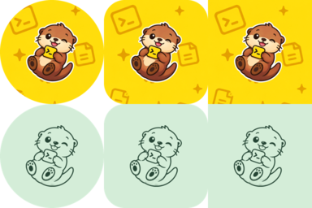
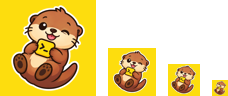
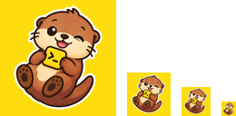
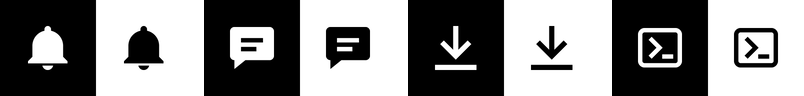

# Icon Otter

Create every icon your app needs from one piece of artwork, straight from the terminal.


Icon Otter turns an SVG, PNG, or JPEG into ready-to-use app icons for Android, iOS, macOS, Windows, Linux and the web, from adaptive launcher icons to `.icns`, `.ico` and favicons. Everything runs locally, without an account, server, or AI service.

[Installation](#installation) · [Quick start](#quick-start) · [Generate launcher icons](#generate-launcher-icons) · [Generate notification icons](#generate-notification-icons) · [Options](#options)

## Installation

With [Homebrew](https://brew.sh) on macOS or Linux:

```sh
brew install alexstyl/tap/iconotter
```

On Windows, or without Homebrew, download the archive for your platform from [GitHub Releases](https://github.com/alexstyl/iconotter/releases/latest), extract it, and move `iconotter` onto your `PATH`.

With Go 1.25.8 or newer:

```sh
go install github.com/alexstyl/iconotter@latest
```

Check the installation with `iconotter --version`.

## Quick start

Supply your own single-color artwork on a transparent background, such as an SVG or PNG:

```sh
iconotter launcher --foreground logo.svg --background '#FFFFFF'
```

This creates `app-icons/` with Android resources, an iOS asset catalog, and previews. `launcher` exports Android and iOS unless you [choose other platforms](#choose-a-platform) with `--platform`. For multicolor Android artwork, also supply a [monochrome silhouette](#multicolor-artwork).

```text
app-icons/
├── android/
│   ├── res/
│   ├── manifest-snippet.xml
│   ├── play-store.png
│   ├── preview.png
│   └── README.md
├── ios/
│   ├── Assets.xcassets/AppIcon.appiconset/
│   ├── preview.png
│   └── README.md
└── README.md
```

Generation never overwrites an existing output directory or edits your app. All selected platforms must succeed before the export is published.

## Features

- **Android launcher icons:** adaptive foreground and background layers, themed monochrome icons, legacy and round icons, and a Play Store image.
- **macOS app icons:** Apple-rendered glass backgrounds with flat foregrounds, a multi-resolution `.icns`, complete `.iconset`, Xcode asset catalog, editable `.icon` document, and preview. An explicit flat style works without Apple tools.
- **iOS app icons:** an opaque 1024×1024 PNG in an Xcode asset catalog.
- **Windows and Linux app icons:** a multi-size `.ico`, and PNGs in the freedesktop `hicolor` theme layout.
- **Web favicons:** `favicon.ico`, 16px and 32px PNG favicons, and an Apple touch icon.
- **Android notification icons:** white artwork on a transparent status-bar canvas.
- **Flexible composition:** trim transparent source padding, preserve aspect ratio, choose a solid color or image background, and adjust content padding—including intentional cropping.
- **Local SVG rendering:** embedded resvg handles paths, shapes, gradients, and internal references without an external renderer.
- **Interactive or scripted:** prompts when artwork is omitted in a terminal; explicit flags for scripts and agents.

## Generate launcher icons

Turn your artwork into app icons for every platform. The otter from the header is [the artwork](assets/examples/otter.png), with [a single-color silhouette](assets/examples/otter-monochrome.png) for Android themed icons, on [the header's pattern](assets/examples/pattern.png):

```sh
iconotter launcher \
  --foreground assets/examples/otter.png \
  --monochrome assets/examples/otter-monochrome.png \
  --background assets/examples/pattern.png \
  --platform android,ios,macos,windows,linux,web
```

| Platform | Output | What you get |
| --- | --- | --- |
| Android |  | Adaptive icon with a themed variant, legacy and round icons, and a Play Store image |
| iOS |  | 1024×1024 icon in an Xcode asset catalog |
| macOS |  | Glass app icon as `.icns`, `.iconset`, asset catalog and editable `.icon` |
| Windows |  | `AppIcon.ico` with 16–256px images |
| Linux |  | 512px icon and the `hicolor` theme from 16 to 512px |
| Web |  | `favicon.ico`, 16px and 32px favicons, and a 180px Apple touch icon |

The examples below change one option at a time and show the Android, iOS and macOS output.

### Use a solid color background

```sh
iconotter launcher \
  --foreground assets/examples/otter.png \
  --monochrome assets/examples/otter-monochrome.png \
  --background '#FDDD0E' \
  --platform android,ios,macos
```


On macOS, Icon Composer renders the glass gradient from your color.

### Use a gradient or image background

```sh
iconotter launcher \
  --foreground assets/examples/otter.png \
  --monochrome assets/examples/otter-monochrome.png \
  --background assets/examples/gradient.svg \
  --platform android,ios,macos
```


`--background` takes a `#RRGGBB` color or an opaque SVG, PNG, or JPEG, such as [this gradient](assets/examples/gradient.svg) or the pattern above. The image is scaled to cover the icon and cropped to its center, never stretched. On Android, the image covers the visible part of the adaptive icon, and the margin launchers reveal when they move the icon mirrors its edges. On macOS glass, the image sits under the artwork as its own layer in the `.icon` document, and Icon Composer renders its glass gradient over it.

### Make the artwork bigger or crop it

```sh
iconotter launcher \
  --foreground assets/examples/otter.png \
  --monochrome assets/examples/otter-monochrome.png \
  --background assets/examples/pattern.png \
  --padding=-12 \
  --platform android,ios,macos
```


Padding is a percentage per side of the visible icon canvas. Positive values inset the artwork; zero fits it to the visible bounds; negative values enlarge and crop it, as above. Aspect ratio is preserved, so rectangular artwork can still leave space along its shorter side.

On Android, padding is measured against the visible inner 72dp of the 108dp adaptive layer. On iOS, it uses the full 1024px canvas. On macOS, it applies inside the visible 824px tile, independently of the fixed transparent outer margins. Android legacy, store, and preview images use the same visible composition. `--padding` and `--size` cannot be combined.

Without `--padding`, Android uses a 56dp bounding diagonal inside the 66dp safe area; iOS fits the longest painted side within 75% of its canvas; macOS uses 75% of its tile; Windows, Linux and web use 90% of the icon. These foreground sizes are composition defaults, not Apple requirements.

### Choose a platform

```sh
iconotter launcher --foreground logo.svg --platform android --output android-icons
iconotter launcher --foreground illustration.png --platform ios --output ios-icons
iconotter launcher --foreground logo.svg --platform macos --name Studio --output mac-icons
iconotter launcher --foreground logo.svg --platform windows,linux --name my-app --output desktop-icons
iconotter launcher --foreground logo.svg --platform web --output web-icons
```

`--platform` accepts comma-separated values or repeated flags. Duplicate selections are ignored. iOS-only artwork can use multiple colors without a silhouette.

### Multicolor artwork

Android themed icons need a single-color mark. The otter has many colors, so the examples above pass [its line art](assets/examples/otter-monochrome.png) with `--monochrome`; you can see it in the themed row of the Android output. Supply any transparent, single-color silhouette the same way:

```sh
iconotter launcher \
  --foreground character.png \
  --monochrome character-silhouette.svg \
  --background '#85C9B4' \
  --output character-icons
```

Single-color foreground artwork can supply its own monochrome silhouette.

## Generate notification icons

Turn a glyph into Android notification icons:

```sh
iconotter notification --foreground assets/examples/glyphs/bell.svg --name ic_stat_bell
```



These are the previews for [the bell, message, download and terminal glyphs](assets/examples/glyphs). Each run creates `notification-icons/android/` with density-specific white icons on a transparent 24dp canvas, ready for `.setSmallIcon(R.drawable.ic_stat_bell)`. Supply a transparent single-color mark or a dedicated silhouette with `--monochrome FILE`. Multicolor and fully opaque artwork are rejected unless a suitable silhouette is supplied.

There is no separate iOS notification export: iOS uses the app icon for notifications.

## Options

| Flag | Applies to | Behavior / default |
| --- | --- | --- |
| `--foreground FILE` | Both commands | SVG, PNG, or JPEG artwork; prompts when omitted in an interactive terminal. |
| `--platform LIST` | Both commands | `launcher`: `android,ios` by default; also accepts `macos`, `windows`, `linux` and `web`. `notification`: `android` only. |
| `--output DIR`, `-o DIR` | Both commands | A new directory; defaults to `app-icons` or `notification-icons`. |
| `--name NAME` | Both commands | Android launcher: `ic_launcher`; iOS/macOS/Windows: `AppIcon`; Linux: `app-icon`; notification: `ic_stat_notification`. |
| `--monochrome FILE` | Android | Transparent single-color silhouette for themed or notification icons. |
| `--background '#RRGGBB'` or `FILE` | Launcher | Opaque solid color or SVG, PNG, or JPEG image; defaults to white. Images cover the icon and are cropped to the center. Windows and Linux icons keep source transparency unless you pass `--background`. |
| `--macos-style STYLE` | macOS launcher | `glass` (default): Apple-rendered background with a flat foreground. Requires Icon Composer on macOS. `flat`: local rendering without Apple tools. |
| `--padding NUMBER` | Launcher | Percent per side, from -100 up to (but not including) 50. Omitted: platform-specific sizing defaults. |
| `--size NUMBER` | Android | Launcher bounding diagonal: 48–66dp, default 56. Notification longest side: 1–24dp, default 22. |
| `--min-sdk NUMBER` | Android | Minimum Android API level; defaults to 21. Launcher exports include legacy icons below 26. |

`--monochrome`, `--min-sdk`, and `--size` are rejected when explicitly passed for an export without Android. A custom `--name` applies to every selected platform. With Android, it must start with a lowercase letter and use only lowercase letters, digits, or underscores; other platforms also accept uppercase letters and hyphens.

For full command help:

```sh
iconotter launcher --help
iconotter notification --help
```

## Limitations and troubleshooting

- **Backgrounds are opaque.** `--background` accepts a `#RRGGBB` color or an image without transparency. For a gradient background, supply it as an image.
- **SVG inputs are rasterized.** All platforms receive raster artwork, not Android vector drawables. SVGs require a `viewBox`; convert text to paths. Linked files, embedded images, scripts, and stylesheets are rejected.
- **Existing image backgrounds remain.** Transparent padding is trimmed, but white or colored backgrounds in PNG/JPEG inputs are not automatically removed. Use transparent artwork for an isolated foreground.
- **Output directory already exists?** Choose a new `--output` directory. Existing exports are never overwritten.
- **Android icon looks unchanged?** Launchers can cache icons after an update. Check the installed resources before assuming export failed; uninstalling to refresh the cache can remove app data.
- **Apple appearance variants:** macOS glass exports include an editable `.icon` document. Exported ICNS and PNG files capture the Default appearance only. iOS exports remain flat asset catalogs. Custom dark, tinted and clear exports are not generated.
- **Input limits:** files must be at most 10 MiB; decoded bitmap images must contain at most 16 million pixels. Preserve attribution required by the artwork's license.

Running a command without artwork in an interactive terminal opens a prompt. Launcher generation also asks for the background color or image when omitted, unless you only export Windows or Linux icons. For scripts, pass flags explicitly: piped invocations fail immediately when artwork is missing. `NO_COLOR` and `ACCESSIBLE=1` support plain accessible prompts. Results go to stdout; errors go to stderr with a nonzero exit status.

## Development and contributing

From a local checkout:

```sh
go test ./...
go vet ./...
go build -o iconotter .
```

SVG rendering uses [resvg](https://github.com/linebender/resvg) compiled to WebAssembly from `resvg/` and embedded in the binary. After changing `resvg/`, install Rust with the `wasm32-unknown-unknown` target, run `go generate`, and commit the rebuilt `resvg/resvg.wasm` and `resvg/THIRD_PARTY_LICENSES.txt`.

Optional native resource compilation checks:

```sh
ICONOTTER_TEST_ANDROID=1 ANDROID_HOME=/path/to/android/sdk ICONOTTER_TEST_XCODE=1 go test ./...
```

The Android check needs SDK platform 33 and build-tools; the Xcode check needs Xcode with the iOS SDK. Flat icon generation requires neither SDK. macOS glass rendering requires Apple’s Icon Composer; the native rendering test runs when its tool is installed. Tests cover image output, alpha channels, platform selection, padding and cropping, native resource compilation, invalid input, and preserving existing files.

Report reproducible bugs and propose changes through the repository's issues and pull requests. Include the command, expected result, and relevant platform details.

## License

Icon Otter is released under the [MIT License](LICENSE).
